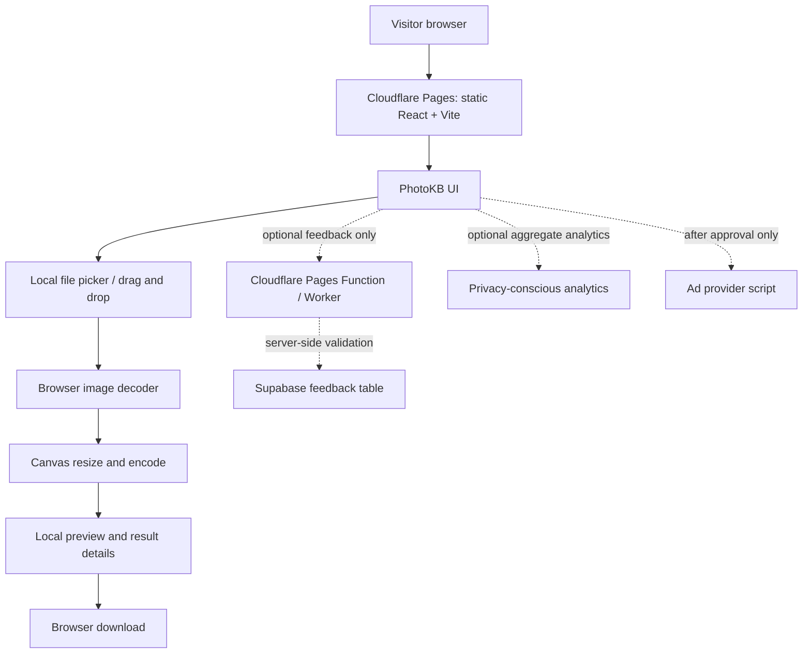

# PhotoKB — Technical Requirements Document (TRD)

> **Document:** TRD  
> **Version:** 1.0  
> **Date:** 12 November 2026  
> **Architecture target:** React + Vite static SPA on Cloudflare Pages  
> **Source of truth:** PhotoKB Master Project Specification v1.1

---

## 1. Purpose and technical principles

This TRD specifies how PhotoKB is to be implemented, tested, secured, and deployed. It converts the PRD into engineering constraints.

### Non-negotiable principles
1. The core compressor works without a backend, database, API key, or user account.
2. Image decoding, resizing, encoding, preview, and download happen in the browser.
3. No user image, signature, filename, or preview is uploaded or sent to a third party.
4. The production frontend is a static React + Vite application suitable for Cloudflare Pages.
5. Supabase is optional and must not become a runtime dependency for compression.
6. The generated output must be honest: measure actual bytes; never fake a successful target result.
7. Design, animation, and ads must not block or obscure the tool.

## 2. System context



**Forbidden data path:** image bytes must never flow from the browser to Cloudflare Functions, Supabase Storage, analytics, or an advertising partner.

## 3. Technology stack

| Layer | Selected technology | Notes |
|---|---|---|
| AI-assisted creation | Google AI Studio Build | Use as code generator/iteration tool, not runtime dependency. |
| Frontend | React + Vite + TypeScript | Static app; keep bundle lean. |
| Styling | CSS variables + component styles | A small animation utility is optional; avoid unnecessary dependencies. |
| Image decode | `createImageBitmap()` with a tested fallback | Browser compatibility must be tested. |
| Image resize | Canvas / OffscreenCanvas where appropriate | Main-thread fallback must remain usable. |
| Encode | `HTMLCanvasElement.toBlob()` | Verify returned Blob and actual MIME type. |
| State | React state/hooks | Keep processing states explicit. |
| Source control | GitHub | Version control and deployment source. |
| Hosting | Cloudflare Pages | Build command `npm run build`, output `dist`. |
| Optional backend | Supabase Postgres | Feedback only unless later justified. |
| Optional anti-abuse | Cloudflare Turnstile + server-side verification | Never trust client-only Turnstile result. |
| Search monitoring | Google Search Console | Search indexing and performance. |
| Ads | Adsterra | Add only after provider approval and policy review. |

## 4. Runtime architecture

### 4.1 Static frontend

- Vite compiles the app into static assets in `dist/`.
- No Node.js application server is required for the core feature.
- Cloudflare Pages serves HTML, JS, CSS, icons, and public metadata.
- All core tool state is ephemeral and held in the current browser tab.
- A refresh may clear the current image/result; disclose this rather than building storage by default.

### 4.2 Suggested repository layout

```text
photokb/
├── public/
│   ├── favicon.svg
│   ├── og-image.png
│   ├── robots.txt
│   └── sitemap.xml
├── src/
│   ├── components/
│   │   ├── SiteHeader.tsx
│   │   ├── UploadDropzone.tsx
│   │   ├── TargetSizeSelector.tsx
│   │   ├── ImageSettingsPanel.tsx
│   │   ├── CompressionProgress.tsx
│   │   ├── ResultPanel.tsx
│   │   ├── FeatureGrid.tsx
│   │   ├── FAQAccordion.tsx
│   │   ├── AdSlot.tsx
│   │   └── SiteFooter.tsx
│   ├── pages/
│   │   ├── HomePage.tsx
│   │   ├── AboutPage.tsx
│   │   ├── PrivacyPage.tsx
│   │   ├── TermsPage.tsx
│   │   └── ContactPage.tsx
│   ├── hooks/
│   │   └── useImageCompressor.ts
│   ├── lib/
│   │   ├── validateImageFile.ts
│   │   ├── decodeImage.ts
│   │   ├── compressImage.ts
│   │   ├── resizeImage.ts
│   │   ├── outputFormat.ts
│   │   ├── formatBytes.ts
│   │   └── downloadBlob.ts
│   ├── i18n/
│   │   ├── en.ts
│   │   └── ur.ts
│   ├── styles/
│   │   ├── tokens.css
│   │   ├── global.css
│   │   └── motion.css
│   ├── App.tsx
│   └── main.tsx
├── functions/                 # optional Pages Functions only if feedback is enabled
│   └── api/feedback.ts
├── supabase/
│   └── migrations/
├── index.html
├── package.json
├── tsconfig.json
├── vite.config.ts
├── .gitignore
├── .env.example
└── README.md
```

If a file or framework feature is not used, omit it. Do not add empty server functions, auth, or a Supabase client just to match this tree.

## 5. Data and file handling

### 5.1 Accepted v1 input
- JPEG / JPG (`image/jpeg`)
- PNG (`image/png`)
- WebP (`image/webp`)

Reject SVG, PDF, GIF (including animated GIF), and unsupported types in v1. HEIC/HEIF is a later feature, not an assumed browser capability.

### 5.2 Validation sequence
1. Confirm a file is selected.
2. Check declared MIME type against the allowlist.
3. Check filename extension only as supporting information, not the only validation mechanism.
4. Where practical, inspect file signature/decode outcome because MIME values can be misleading.
5. Enforce configurable file byte limit (initial suggested ceiling: 15 MB, subject to device testing).
6. Decode and read pixel dimensions.
7. Enforce configurable maximum width, height, and total pixel count.
8. Catch decoder failures and return a user-friendly error.
9. Do not log or transmit file bytes or user filename.

### 5.3 Temporary resources
- Use a local `File` object and `URL.createObjectURL()` for preview when useful.
- Revoke every temporary object URL when replacing/resetting the image or unmounting the relevant component.
- Release canvas references and image bitmap resources after processing.
- Do not write original files or results to localStorage, IndexedDB, or remote storage in v1.

## 6. Compression engine requirements

### 6.1 Inputs
A typed compression request should include:

```ts
export type OutputFormat = 'image/jpeg' | 'image/png' | 'image/webp';

export interface CompressionRequest {
  file: File;
  targetBytes: number;
  outputFormat: OutputFormat;
  width?: number;
  height?: number;
  maintainAspectRatio: boolean;
  jpegBackground?: string; // required/disclosed when flattening transparency to JPEG
  preferredQuality?: number;
}
```

### 6.2 Output

```ts
export interface CompressionResult {
  blob: Blob;
  mimeType: string;
  bytes: number;
  width: number;
  height: number;
  targetBytes: number;
  targetReached: boolean;
  quality?: number;
  attempts: number;
  warnings: string[];
}
```

### 6.3 Algorithm

1. Decode the file and normalize orientation where the browser decoder supports it.
2. Calculate output dimensions, respecting the aspect-ratio lock by default.
3. Never upscale unless user explicitly requests it.
4. Draw to a canvas with the requested background if transparency must be flattened to JPEG.
5. Encode using `toBlob()` in the selected format.
6. Measure `blob.size` in bytes.
7. For JPEG/WebP, if above target, perform a bounded quality search (example range 0.35–0.95) with a limited number of attempts.
8. If still too large, reduce dimensions proportionally and retry, respecting a minimum dimension and total iteration limit.
9. For PNG, do not pretend JPEG-style quality controls apply; suggest a smaller dimension or appropriate lossy format if needed.
10. Return the best valid Blob, exact size, dimensions, attempts, warnings, and `targetReached` boolean.
11. If target is not reached, show actual size and advice. Never label it successful.

### 6.4 Pseudocode

```text
validate request
image = decode locally
size = calculate output dimensions
bestBlob = none
attempts = 0
while attempts < MAX_ATTEMPTS:
    canvas = draw image at size
    blob = encode canvas using selected format and quality
    if blob is null: fail with actionable error
    attempts += 1
    if blob.bytes <= targetBytes:
        return targetReached result
    remember best candidate
    if lossy format and quality can be lowered safely:
        adjust quality with bounded search
    else if dimensions can be reduced safely:
        reduce width and height proportionally
    else:
        break
return best candidate with targetReached=false
```

### 6.5 Algorithm constraints
- Use byte count, not rounded KB, for target comparisons.
- Define UI KB convention consistently; recommended 1 KB = 1,000 bytes.
- Quality is not a predictable file-size slider; always measure the resulting Blob.
- `toBlob()` may return `null`; handle it.
- The output MIME type must be checked. Browsers may fall back to PNG if a requested encoder is unsupported.
- File extension must match the actual Blob MIME type.
- Canvas re-encoding may remove EXIF and other metadata; disclose that metadata may not be preserved.
- Do not promise animation, camera metadata, colour profile, or all device-specific information is preserved.
- Bound all loops and memory-heavy allocations.

## 7. Frontend state model

Recommended application states:

```ts
type ToolStatus =
  | 'idle'
  | 'validating'
  | 'loading'
  | 'ready'
  | 'compressing'
  | 'success'
  | 'target-not-reached'
  | 'error';
```

Transitions must be explicit. A new image selection resets stale output/result state. Reset clears previews and object URLs. Failed processing must never leave a stale “success” panel visible.

## 8. Optional Supabase integration

### 8.1 Launch decision

Supabase is not required for the compressor. Do not add Supabase environment variables or a client library unless an actual feedback/contact feature is shipped.

### 8.2 If feedback is added
- Store only category, message, optional email, UUID, and created timestamp.
- Never store images, signatures, filenames, or image metadata.
- Apply strict input constraints and spam controls.
- Enable RLS on every exposed table.
- Do not expose broad read or update permissions to anonymous visitors.
- Prefer a server-side Cloudflare Pages Function or Supabase Edge Function to validate Turnstile, enforce limits, and write the submission using a server-only key.
- Store server-only secrets in Cloudflare/Supabase encrypted environment settings. Never prefix secrets with `VITE_` or bundle them into the browser.

## 9. Security requirements

- No secret/service-role keys in frontend source, `.env.example`, Git history, or output bundle.
- Use public/publishable key only if client-side access is genuinely necessary.
- RLS must be enabled for every public schema table used by the app.
- Do not use `dangerouslySetInnerHTML` for user-controlled content.
- Do not render SVG uploads.
- No raw file content or personal filename in analytics events.
- Use HTTPS.
- Restrict third-party scripts to those actually required and approved.
- Validate feedback again server-side if implemented.
- Review dependencies and update them deliberately.

## 10. Privacy and network acceptance

Before release, inspect browser developer tools:
- Select and compress sample images.
- Inspect Network requests.
- Confirm no request body contains image bytes, image data URLs, signatures, previews, or filenames.
- Confirm no image-processing API endpoint exists.
- Confirm advertising and analytics scripts do not receive image contents.
- Confirm temporary image URLs are revoked after reset/replacement.

## 11. UX, accessibility, and responsive technical requirements

- Semantic landmarks and headings.
- Every input has a programmatic label.
- Focus-visible styles for every interactive element.
- Keyboard accessible upload button, target controls, settings disclosure, FAQ, and menu.
- Do not communicate success/error by colour alone.
- Respect `prefers-reduced-motion`.
- Set document language; Urdu content uses RTL direction.
- Mobile touch targets should be at least 44 px where practical.
- Test 360 px, 390 px, 768 px, 1024 px, and large desktop layouts.
- No horizontal overflow.

## 12. SEO technical requirements

- English is the default crawlable language.
- Unique title, description, one useful H1, logical H2/H3 hierarchy.
- Canonical URL placeholder must be replaced with the real domain before launch.
- Valid `robots.txt` and `sitemap.xml` with the actual canonical URLs.
- Open Graph and social card metadata.
- Semantic HTML, descriptive links, useful alt text.
- Supporting pages should be reachable and refresh correctly.
- Do not claim FAQ structured data guarantees rich results.
- Client-only Urdu toggle does not automatically create indexable Urdu landing pages; separate language URLs require correct canonical/hreflang strategy.

## 13. Build and deployment requirements

### Local commands

```bash
npm install
npm run dev
npm run build
npm run preview
```

### Cloudflare Pages

| Setting | Value |
|---|---|
| Framework | React / Vite |
| Production branch | `main` |
| Root directory | `/` unless repo uses a subfolder |
| Build command | `npm run build` |
| Output directory | `dist` |
| Node version | Supported current LTS pinned deliberately if necessary |

Connect the GitHub repository to Cloudflare Pages. Use preview deployments for changes and promote only tested code to `main`.

## 14. GitHub requirements

- Commit the working baseline before major changes.
- Ignore `node_modules/`, `dist/`, `.env`, `.env.*` except `.env.example`, local editor files, and OS files.
- Never commit private keys, provider tokens, real user images, or test images that include personal data.
- Use meaningful commits and review AI-generated changes before merging.

## 15. Performance requirements

- Avoid large animation frameworks if CSS and IntersectionObserver are sufficient.
- Use transform/opacity for animation instead of layout-heavy properties.
- Do not load ad scripts until provider approval and a real placement exists.
- Keep initial JS and CSS reasonable.
- Avoid repeated huge canvas allocations; release resources.
- Consider Web Workers only after profiling large-image use cases.
- Test on a mid-range Android device and a slower network.

## 16. Testing requirements

### Functional
- JPEG, PNG, WebP input.
- Invalid type, oversize file, extreme dimensions.
- Every preset and custom target.
- Maintain/unlock aspect ratio.
- PNG transparency to JPEG.
- Correct MIME and extension.
- Download, reset, and repeated compression.
- Target-not-reached state.

### Visual and accessibility
- Desktop, tablet, mobile.
- English and Urdu/RTL.
- Keyboard-only operation.
- Screen reader labels for primary controls.
- Reduced motion.

### Deployment
- Build succeeds.
- Cloudflare deploy succeeds.
- HTTPS works.
- Direct URL refresh works on supporting pages.
- `robots.txt`, sitemap, and canonical metadata are valid.
- No secret is present in built bundle.

## 17. Definition of technical completion

The technical implementation is complete when the production build passes, the complete main tool flow passes on tested browsers, the compression output is measured accurately, no personal image content leaves the browser, and the deployed Cloudflare Pages site passes the documented QA checklist.

---

**Related:** PRD, App Flow, UI/UX Design Brief, Backend Schema, Implementation Plan.
