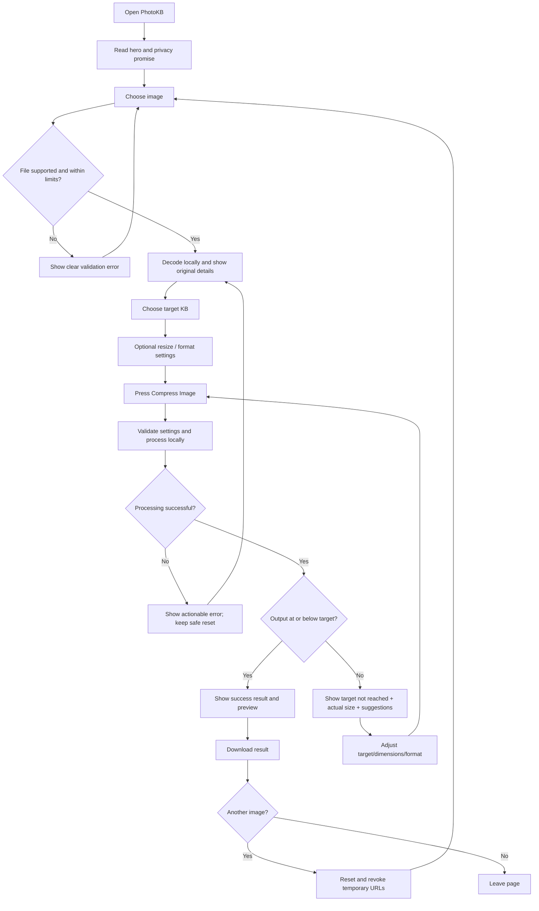
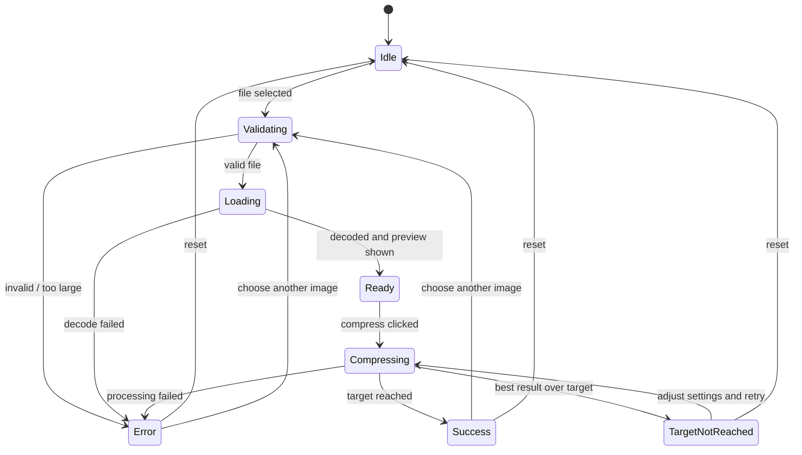
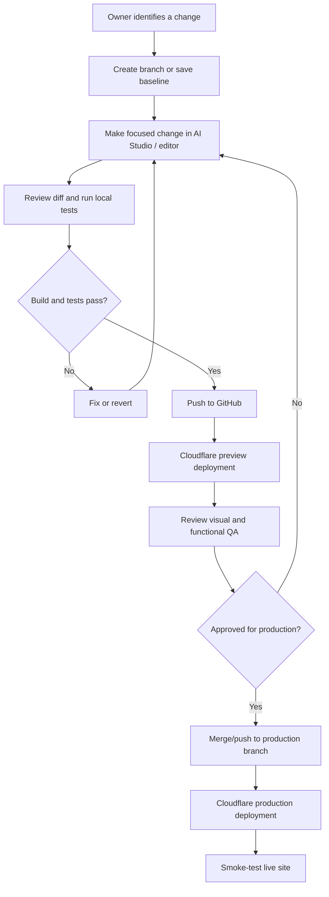

# PhotoKB — App Flow (User and Admin Experience)

> **Document:** App Flow  
> **Version:** 1.0  
> **Date:** 12 November 2026  
> **Product model:** Public single-page utility; no visitor accounts and no custom admin dashboard in v1

---

## 1. Purpose

This document describes the end-to-end experience of a visitor using PhotoKB and the operating workflows of the site owner/admin. “Admin” means the site owner/operator managing the website, deployment, optional feedback, and monetization through provider dashboards. It does **not** imply a custom admin panel in the first release.

## 2. Information architecture

### Main public page
- Header/navigation.
- Hero.
- Main compressor tool.
- Supported formats and privacy strip.
- Feature showcase / benefits.
- Use cases.
- Value/privacy panels.
- Format compatibility section.
- Honest comparison / explanation.
- How it works.
- FAQ.
- Final CTA.
- Footer.

### Supporting routes
- `/about`
- `/privacy`
- `/terms`
- `/contact`

The product remains a single main tool page. Supporting legal/trust pages do not add unrelated tools.

## 3. Visitor main flow

## 4. Detailed user journey

### 4.1 Landing / first visit
1. Visitor lands on the homepage.
2. Sticky header offers Tool, Features, How It Works, FAQ, language toggle, and a CTA that scrolls to the tool.
3. Hero explains what PhotoKB does in one glance.
4. Main compressor is visible without requiring the user to scroll through long marketing content.
5. A short privacy note says image processing happens in the browser, only if verified by the implementation.

### 4.2 Upload
1. Visitor presses “Choose Image” or drags a file into the dropzone.
2. During drag-over, the dropzone receives a visual highlight.
3. After selection, the file is validated.
4. If invalid, show a useful message and supported formats.
5. If valid, decode locally and show original image preview plus file details.

### 4.3 Target selection
1. Visitor chooses one preset: 20 KB, 50 KB, 100 KB, 200 KB, 500 KB.
2. Or selects Custom and enters a positive KB value.
3. If input is invalid, show inline validation and disable compression until corrected.
4. Clarify that the target means “maximum output size”, not a guaranteed exact byte count.

### 4.4 Optional settings
- Output format: Auto/recommended, JPEG, PNG, WebP when supported.
- Width and height in pixels.
- Maintain aspect ratio: on by default.
- Quality preference: optional and supported formats only.
- JPEG background: visible setting when transparency is flattened.
- On mobile, advanced settings can be inside an accessible disclosure to keep the first view simple.

### 4.5 Compression
1. Visitor presses “Compress Image”.
2. Tool changes to a real loading/compressing state.
3. Progress is determinate only if measurable; otherwise use an indeterminate progress treatment and accurate status text.
4. The browser performs decode, canvas resize, encode, and byte measurement.
5. The UI remains responsive where possible; large workloads may later use a Web Worker.

### 4.6 Result
Display:
- Before and after preview.
- Original file size and output size.
- Original and output dimensions.
- Output format.
- Size reduction percentage (only when mathematically meaningful).
- Target status: “Within target” or “Target not reached”.
- Download action.
- Compress another image action.

If the target is not reached, never show a success badge. Explain that the desired size could not be reached within safe quality/dimension limits and suggest reducing dimensions, choosing a different supported format, or selecting a larger target.

### 4.7 Reset / next image
- Reset clears current image, result, settings as appropriate, error state, and temporary previews.
- Revoke old object URLs.
- Return focus to the upload control where practical.
- Do not retain a stale success result after a new upload or processing error.

## 5. Signature flow

The signature workflow uses the same engine, with helpful copy and no server upload. Visitors may upload an image of a handwritten signature, choose a required target size, optionally adjust dimensions, preview and download.

Privacy requirements are especially important: signature images must not be sent to analytics, ads, backend, Supabase, or support logs. The app must not claim that every result meets any particular authority's signature requirements.

## 6. UI state flow / state machine

### State definitions
| State | What visitor sees | Available actions |
|---|---|---|
| Idle | Empty upload zone | Choose file / drop file |
| Validating | File validation indicator | Wait or choose a different file |
| Loading | Image loading message | Wait; reset if supported |
| Ready | Original preview and settings | Change target, dimensions, format; compress; reset |
| Compressing | Real/indeterminate progress | Wait; prevent duplicate submission |
| Success | Actual result, preview, size, target status | Download; compress another; reset |
| Target not reached | Best valid output plus actual size and suggestions | Adjust settings and retry; download only with clear status; reset |
| Error | Actionable error | Retry, choose another file, reset |

## 7. Validation and error flows

| Condition | User message intent | Recovery |
|---|---|---|
| No file | Ask user to choose an image | Open file picker |
| Unsupported file | Explain accepted JPG, PNG, WebP formats | Choose supported file |
| Input too large | Show configurable max file size | Use smaller file |
| Dimensions too large | Explain device-safe dimension limit | Use a smaller image or safe downscale option |
| Corrupt/unreadable image | Explain file could not be read | Re-export or choose another file |
| Invalid custom KB | Explain allowed numeric range | Correct value |
| Canvas encoding failure | Explain conversion failed | Try another format/browser |
| Output target missed | Show actual size and reason where known | Lower dimensions, change format, or increase target |
| Browser memory failure | Suggest smaller source image | Retry with smaller image |
| Download failure | Keep result available and provide retry | Retry download |

Never show raw stack traces, internal file paths, or developer-only error details.

## 8. Admin / site-owner experience

### 8.1 Admin scope in v1
There is no custom admin login or dashboard. The owner/operator uses:
- Google AI Studio for generation and iteration.
- GitHub for source control and review.
- Cloudflare Pages for deployments, domain, environment settings, and build logs.
- Supabase dashboard only if optional feedback storage is enabled.
- Adsterra publisher dashboard only after site moderation/approval.
- Google Search Console for indexing and organic search monitoring.

### 8.2 Admin release flow

### 8.3 Admin operational tasks
- Review build logs after each deployment.
- Confirm the production URL and HTTPS.
- Test one JPG, PNG, and WebP file after major updates.
- Check Search Console for indexing and errors.
- Update legal page statements if analytics, ads, or data collection changes.
- Verify Adsterra code and current terms before installing or changing ad formats.
- Never request or collect users' photo/signature files for troubleshooting.

### 8.4 Feedback moderation (optional)
If feedback is enabled, the operator may view submissions in a restricted provider dashboard/SQL console. Public visitors must not be able to read submissions. Limit retention and remove abusive or unnecessary personal data according to the published policy. A future custom admin UI requires a separate authorization model and is outside v1 scope.

## 9. Navigation and interaction map

| Element | Action |
|---|---|
| PhotoKB logo | Navigate to top/home |
| Tool link | Scroll to compressor |
| Features link | Scroll to features section |
| How It Works link | Scroll to steps section |
| FAQ link | Scroll to FAQ |
| Language toggle | Switch English/Urdu; set direction appropriately |
| Hero primary CTA | Scroll/focus tool upload area |
| Hero secondary CTA | Scroll to how-it-works |
| Choose Image | Open file picker |
| Dropzone | Accept supported file drag/drop |
| Target size chip | Set maximum target bytes |
| Custom target input | Set validated max bytes |
| Settings disclosure | Open/close dimensions and format settings |
| Compress Image | Start one compression operation |
| Download | Save actual output Blob |
| Compress another | Reset and focus upload |
| FAQ row | Toggle answer with keyboard and pointer |
| Footer trust links | Navigate to supporting pages |

## 10. Admin permissions and security model

Because no custom admin UI exists in v1:
- Do not create a public admin route.
- Do not hardcode an admin password or secret in the frontend.
- Provider dashboards must use the owner's own account-level authentication and MFA where available.
- Supabase tables must use RLS; no public select on feedback.
- Secrets remain in Cloudflare/Supabase encrypted settings.

## 11. Analytics and privacy boundaries

If privacy-conscious aggregate analytics is enabled, track only high-level interactions (for example, tool start, completion, format category, target preset category) without sending filename, image bytes, preview, signature, or identifying metadata. Confirm local legal requirements and provider terms. If no consent/notice approach is defined, do not enable non-essential tracking by default.

---

**Related documents:** PRD, TRD, UI/UX Design Brief, Backend Schema, Implementation Plan.
