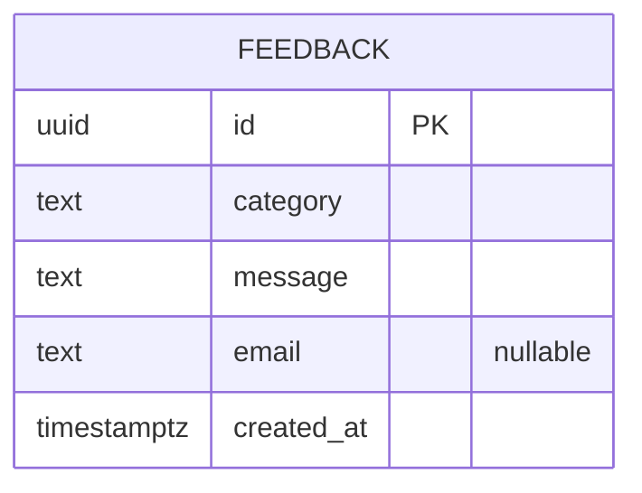
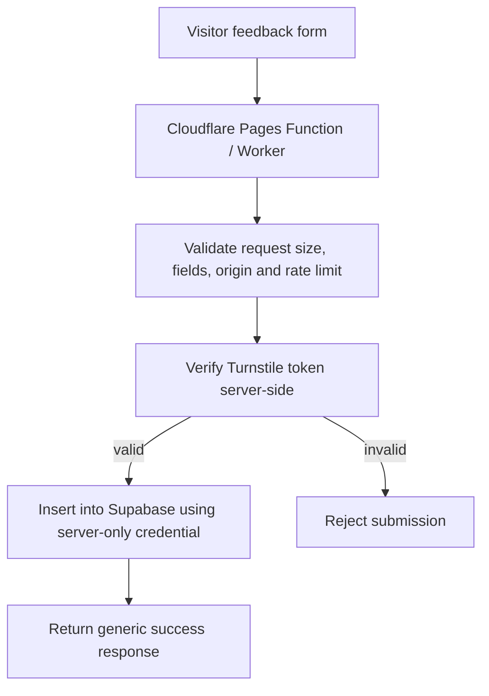

# PhotoKB — Backend Schema and Supabase Plan

> **Document:** Backend Schema  
> **Version:** 1.0  
> **Date:** 12 November 2026  
> **Database:** Supabase Postgres (optional)  
> **Core product dependency:** None — compression must work without Supabase

---

## 1. Critical architecture decision

**PhotoKB does not need a backend or database to compress images.** The image-processing engine runs locally in the visitor's browser. Do not upload images, signatures, previews, filenames, image bytes, or image metadata to Supabase or any server.

For v1, the recommended production configuration is:
- No user accounts.
- No authentication system.
- No image storage bucket.
- No compression table or compression job queue.
- No custom admin dashboard.
- Supabase omitted unless an optional feedback feature is genuinely needed.

This document defines the minimal optional feedback schema and a future-safe approach without inventing unnecessary database tables.

## 2. Data that PhotoKB must never store

Do not store:
- Original photos or signatures.
- Compressed images or previews.
- Image data URLs/base64 strings.
- User filenames or local file paths.
- EXIF metadata or other personal image metadata.
- Government IDs, passport details, application numbers, or form credentials.
- Unnecessary user profile data.

## 3. Optional feedback feature

### 3.1 When to enable
Only add feedback if the site owner has a real need to collect bug reports or suggestions and is prepared to publish an accurate privacy notice, protect the endpoint from spam, and maintain the data.

### 3.2 Proposed minimal table

Table: `public.feedback`

| Column | Type | Required | Rules / purpose |
|---|---|---:|---|
| `id` | `uuid` | Yes | Primary key, generated by database. |
| `category` | `text` | Yes | `bug`, `suggestion`, or `other`. |
| `message` | `text` | Yes | Trimmed length 10–2000 characters. |
| `email` | `text` | No | Optional; max 254 chars; collect only if reply is needed. |
| `created_at` | `timestamptz` | Yes | Database-generated timestamp. |

No `name`, phone, image, signature, file, or user-agent column is needed by default.

### 3.3 Entity relationship



There are no user, image, storage, job, or admin tables in the v1 schema.

## 4. SQL migration — optional feedback table

Create a migration such as `supabase/migrations/0001_create_feedback.sql`:

```sql
create table if not exists public.feedback (
  id uuid primary key default gen_random_uuid(),
  category text not null
    check (category in ('bug', 'suggestion', 'other')),
  message text not null
    check (char_length(btrim(message)) between 10 and 2000),
  email text null
    check (email is null or char_length(email) <= 254),
  created_at timestamptz not null default now()
);

alter table public.feedback enable row level security;

-- No public read, update, or delete access.
revoke all on table public.feedback from anon, authenticated;

-- Preferred design: write only through a protected server-side endpoint.
-- Do not grant direct anonymous insert if a server-side anti-abuse path is not implemented.
```

The migration intentionally does **not** create a public read policy or grant unrestricted anonymous access.

## 5. Recommended secure submission architecture

### 5.1 Preferred path



- Browser submits only category, message, optional email, and a Turnstile token.
- Server-side endpoint validates content and request size.
- Turnstile is verified server-side using its secret.
- Apply rate limiting and origin checks as additional controls.
- The Supabase server-only credential is stored as an encrypted Cloudflare secret, never in the frontend bundle or GitHub.
- The endpoint returns a minimal response; it does not expose stored feedback records.

### 5.2 Why client-side Turnstile validation is insufficient
A visitor can bypass browser-side JavaScript. The server must verify the Turnstile token before accepting a submission. Do not treat a client-supplied “verified” boolean as proof.

### 5.3 Simpler alternative
If the owner does not want to maintain a secure server endpoint, omit the feedback form and Supabase entirely in v1. A real contact email can be added once provided by the owner.

## 6. Access control and RLS

- Enable RLS on every table exposed through Supabase's API.
- Do not create a public `SELECT`, `UPDATE`, or `DELETE` policy for feedback.
- Prefer the server-only insert path above, leaving anonymous browser roles without table permissions.
- If a direct public insert design is ever chosen, it requires a documented abuse-control strategy and carefully restricted RLS policy; it is not the default recommendation.
- Site-owner review of feedback should occur through authenticated provider administration or a controlled server-side process, not a public endpoint.

## 7. Secrets and environment variables

### Frontend
No Supabase variables are necessary when the feature is disabled.

If a public Supabase client is deliberately used in a future feature, only its publishable key may be exposed, and RLS must be correctly configured. `VITE_` variables are bundled into browser code and must never contain a secret.

### Server-side optional feedback endpoint
Example names (set values only in Cloudflare's encrypted environment settings):

```text
SUPABASE_URL=
SUPABASE_SERVICE_ROLE_KEY=
TURNSTILE_SECRET_KEY=
TURNSTILE_SITE_KEY=   # site key is public if needed by the page
```

Never commit actual values. Never place `SUPABASE_SERVICE_ROLE_KEY` or `TURNSTILE_SECRET_KEY` in a `VITE_` variable, client source, HTML, or generated public asset.

## 8. Supabase Storage

**No storage bucket is required.** Do not create a bucket for user photos, signatures, temporary compression files, or previews. If a future feature has a defensible need for storage, it requires a separate privacy, retention, access-control, and deletion design.

## 9. Authentication and admin model

- No public account system in v1.
- No visitor login or saved history.
- No custom admin login or admin dashboard.
- Owner administers Supabase through the authenticated Supabase project dashboard if feedback is enabled.
- Enable MFA on provider accounts where available.
- Never implement a frontend “admin password” or hide an admin route with a hardcoded secret.

A future dashboard would require a proper auth provider, role model, server-side authorization, audit trail, and a separate threat review. It is explicitly outside v1 scope.

## 10. Data retention and deletion

Before enabling feedback:
- Choose and publish a retention period appropriate to the use (owner decision required).
- Delete submissions that are no longer needed.
- Restrict who can access the table.
- Provide a contact route for privacy requests where applicable.
- Do not retain feedback forever by default.

The precise retention period is an owner/legal decision and must not be invented in the public policy.

## 11. Backup and migration management

- Store SQL migrations in the GitHub repository.
- Apply migrations deliberately and verify the resulting table/policies.
- Avoid manual schema changes that are not captured in version control.
- Back up only the minimum data needed under the provider's supported plan and policy.
- Test RLS and server endpoint behavior before enabling production submissions.

## 12. Database acceptance checklist

- [ ] Core compressor works with no Supabase project configured.
- [ ] No image-related table or bucket exists.
- [ ] Feedback table is created only if required.
- [ ] RLS is enabled on `feedback`.
- [ ] Public select/update/delete access is absent.
- [ ] Feedback inputs are validated server-side.
- [ ] Turnstile is verified server-side if used.
- [ ] Rate limiting and request-size limits are active if public endpoint is exposed.
- [ ] Server-only credentials are encrypted in provider settings.
- [ ] No secret appears in GitHub or client build.
- [ ] Privacy Policy accurately describes the feedback collection.
- [ ] A retention/deletion rule has been decided and documented.

---

**Related documents:** PRD, TRD, App Flow, UI/UX Design Brief, Implementation Plan.
